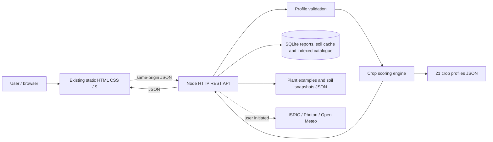
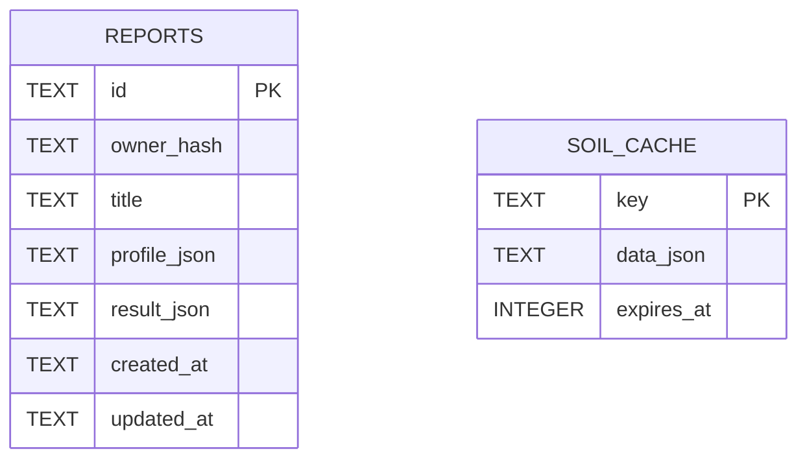

# Architecture and actual SQLite schema

Reports have no foreign key to a profile table: profile and full rankings are immutable snapshots in JSON. Report title can change independently. The cache is unrelated. Scored crop profiles remain in files; the original plant source file seeds the indexed SQLite catalogue. Schema initialization uses `CREATE TABLE IF NOT EXISTS` on startup, with a one-time catalogue seed migration marker, without a general migrations framework. SQLite WAL and parameterized statements are used. Result calculation is transient until the user saves; saving always recalculates server-side.

## Satellite map and indexed catalogue (added)
The browser loads locally bundled Leaflet and requests EOX Sentinel-2 2016/17 tiles directly. Submitted place search reuses the server geocoder; selected coordinates automatically update the field profile with provenance safeguards; no satellite pixel is interpreted as a soil measurement. On startup the backend adds SQLite `catalogue_plants`, `catalogue_tags`, FTS5 `catalogue_search`, and `catalogue_migrations` tables. The original `reports` and `soil_cache` remain. New `/api/catalogue` routes query this index; the old `/api/plants` route remains compatible. A source-linked `screened_crop_id` connects a catalogue entry to the existing 21-crop engine. See [MAP_AND_CATALOGUE.md](MAP_AND_CATALOGUE.md).

## 2026 audit additions
`client/geometry.js` is shared by the browser and Node through a small UMD wrapper. It validates a single simple non-antimeridian polygon with 3–100 vertices within 1° and Web Mercator's latitude limits, calculates approximate spherical area, and tests whether the rounded six-decimal projected centroid is strictly interior; otherwise it searches interior scanline intervals. Failure to represent an interior point at that precision rejects the outline. These methods are not surveyed measurements. Geometry is optional, is sent separately from the profile, and is revalidated/recomputed server-side. The nullable `reports.field_json` was added non-destructively. Existing rows read as `null`. Its profile location must match the computed point. The client shows both area units, permits undo during drawing or editing, restores saved outlines, and exports CSV in the browser; print invokes the browser print dialog, where PDF is a browser option.

`PORT` is honored unless `TERRAFIELD_PORT` overrides it; if `PORT` exists and no `TERRAFIELD_HOST` is set, the server listens on `0.0.0.0` for hosting. No identity provider, production-grade authentication, PostgreSQL or horizontally scalable datastore exists. Route-level bearer-key checks are not a substitute.
